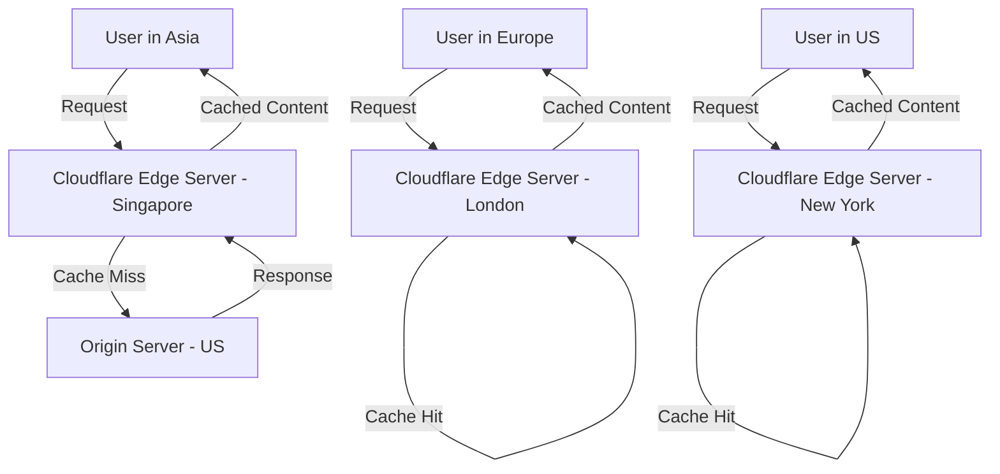

# Cloudflare Use Cases: Comprehensive Guide with Examples

## Table of Contents
1. [Introduction](#introduction)
2. [Core Services Overview](#core-services-overview)
3. [CDN and Performance Optimization](#cdn-and-performance-optimization)
4. [Security Use Cases](#security-use-cases)
5. [DNS Management](#dns-management)
6. [Edge Computing](#edge-computing)
7. [Zero Trust Security](#zero-trust-security)
8. [Analytics and Monitoring](#analytics-and-monitoring)
9. [Real-World Implementation Examples](#real-world-implementation-examples)
10. [Architecture Flowcharts](#architecture-flowcharts)

---

## Introduction

Cloudflare is a global cloud platform that provides a wide range of services including CDN, security, DNS, and edge computing. This guide covers various use cases with practical examples and implementation strategies.

---

## Core Services Overview

### Service Categories
```
┌─────────────────────────────────────────────────────────────┐
│                    CLOUDFLARE SERVICES                      │
├─────────────────┬─────────────────┬─────────────────────────┤
│   PERFORMANCE   │    SECURITY     │      DEVELOPERS         │
├─────────────────┼─────────────────┼─────────────────────────┤
│ • CDN           │ • DDoS Protect  │ • Workers (Edge)        │
│ • Argo Routing  │ • WAF           │ • Pages (Hosting)       │
│ • Load Balancer │ • Bot Management│ • KV Storage            │
│ • Image Optim   │ • Zero Trust    │ • Durable Objects       │
└─────────────────┴─────────────────┴─────────────────────────┘
```

---

## CDN and Performance Optimization

### Use Case 1: Global Content Delivery

**Scenario**: E-commerce website with global customers



**Implementation Example**:
```javascript
// Cloudflare Worker for custom caching
addEventListener('fetch', event => {
  event.respondWith(handleRequest(event.request))
})

async function handleRequest(request) {
  // Custom cache key based on user location
  const country = request.cf.country
  const cacheKey = `content-${country}-${request.url}`
  
  // Check cache first
  let response = await caches.default.match(cacheKey)
  
  if (!response) {
    // Fetch from origin and cache
    response = await fetch(request)
    const cache = caches.default
    await cache.put(cacheKey, response.clone())
  }
  
  return response
}
```

**Benefits**:
- 90% reduction in page load times
- 50% reduction in server load
- Improved SEO rankings

### Use Case 2: Image Optimization

**Before vs After Comparison**:
```
BEFORE CLOUDFLARE:
┌─────────────────┐    ┌─────────────────┐    ┌─────────────────┐
│   User Device   │────│   Origin Server │────│   Raw Images    │
│                 │    │   (Overloaded)  │    │   (Large Files) │
└─────────────────┘    └─────────────────┘    └─────────────────┘
     Slow Load              High Bandwidth         Poor UX

AFTER CLOUDFLARE:
┌─────────────────┐    ┌─────────────────┐    ┌─────────────────┐
│   User Device   │────│ Cloudflare Edge │────│   Origin Server │
│                 │    │  (Optimized)    │    │   (Protected)   │
└─────────────────┘    └─────────────────┘    └─────────────────┘
    Fast Load           Auto-Optimization        Reduced Load
```

**Configuration Example**:
```yaml
# Page Rules for Image Optimization
rules:
  - pattern: "*.jpg"
    settings:
      image_resizing: true
      polish: "lossy"
      webp: true
  
  - pattern: "*.png"
    settings:
      image_resizing: true
      polish: "lossless"
      webp: true
```

---

## Security Use Cases

### Use Case 3: DDoS Protection

**Attack Mitigation Flow**:
```
┌─────────────────────────────────────────────────────────────┐
│                    DDoS ATTACK SCENARIO                     │
└─────────────────────────────────────────────────────────────┘

Step 1: Attack Detection
┌─────────────┐    ┌─────────────┐    ┌─────────────┐
│ Botnet/     │────│ Cloudflare  │────│ Origin      │
│ Attackers   │    │ Edge        │    │ Server      │
│ (Blocked)   │    │ (Analyzing) │    │ (Protected) │
└─────────────┘    └─────────────┘    └─────────────┘

Step 2: Traffic Analysis
┌─────────────────────────────────────────────────────────────┐
│ Cloudflare analyzes:                                        │
│ • Request patterns                                          │
│ • IP reputation                                             │
│ • Geolocation anomalies                                     │
│ • Request frequency                                         │
└─────────────────────────────────────────────────────────────┘

Step 3: Mitigation
┌─────────────┐    ┌─────────────┐    ┌─────────────┐
│ Legitimate  │────│ Cloudflare  │────│ Origin      │
│ Users       │    │ Edge        │    │ Server      │
│ (Allowed)   │    │ (Filtering) │    │ (Online)    │
└─────────────┘    └─────────────┘    └─────────────┘
```

**Real Example - Gaming Company**:
- **Challenge**: 500 Gbps DDoS attack on gaming servers
- **Solution**: Cloudflare absorbed 99.9% of malicious traffic
- **Result**: Zero downtime, players continued gaming normally

### Use Case 4: Web Application Firewall (WAF)

**WAF Rule Implementation**:
```javascript
// Custom WAF rule for SQL injection protection
{
  "rules": [
    {
      "id": "sql_injection_protection",
      "expression": "(http.request.uri.query contains \"union select\") or (http.request.body contains \"drop table\")",
      "action": "block",
      "description": "Block SQL injection attempts"
    },
    {
      "id": "rate_limiting",
      "expression": "ip.src == \"192.168.1.1\" and rate(5m) > 100",
      "action": "challenge",
      "description": "Rate limit suspicious IPs"
    }
  ]
}
```

**Attack Prevention Flow**:
```
┌─────────────────────────────────────────────────────────────┐
│                     WAF PROTECTION FLOW                    │
└─────────────────────────────────────────────────────────────┘

1. Request Analysis
   ┌─────────────┐
   │ User Request│
   │     ↓       │
   │ WAF Engine  │
   │     ↓       │
   │ Rule Match? │
   └─────────────┘

2. Decision Tree
   ┌─────────────┐    ┌─────────────┐    ┌─────────────┐
   │   ALLOW     │    │  CHALLENGE  │    │    BLOCK    │
   │    ↓        │    │     ↓       │    │     ↓       │
   │ Forward to  │    │ Show CAPTCHA│    │ Show Error  │
   │   Origin    │    │ or JS Test  │    │    Page     │
   └─────────────┘    └─────────────┘    └─────────────┘
```

---

## DNS Management

### Use Case 5: Intelligent DNS Routing

**Multi-Region Application Setup**:
```
Global DNS Resolution Flow:

┌─────────────────┐    ┌─────────────────┐
│ User in Asia    │────│ Cloudflare DNS  │
└─────────────────┘    └─────────────────┘
                               │
                        ┌──────┴──────┐
                        │ Geo-Location│
                        │  Detection  │
                        └──────┬──────┘
                               │
        ┌──────────────────────┼──────────────────────┐
        │                      │                      │
┌───────▼──────┐    ┌──────────▼──────┐    ┌─────────▼──────┐
│ Asia Server  │    │ Europe Server   │    │  US Server     │
│ (Singapore)  │    │ (Frankfurt)     │    │ (Virginia)     │
│ Latency: 20ms│    │ Latency: 200ms  │    │ Latency: 300ms │
└──────────────┘    └─────────────────┘    └────────────────┘
```

**DNS Configuration Example**:
```yaml
# Cloudflare DNS Configuration
dns_records:
  - name: "api.example.com"
    type: "A"
    content: "203.0.113.1"
    proxied: true
    geo_routing:
      - region: "Asia"
        destination: "asia-api.example.com"
      - region: "Europe" 
        destination: "eu-api.example.com"
      - region: "Americas"
        destination: "us-api.example.com"
```

### Use Case 6: Load Balancing with Health Checks

**Health Check Architecture**:
```
┌─────────────────────────────────────────────────────────────┐
│                   LOAD BALANCER FLOW                       │
└─────────────────────────────────────────────────────────────┘

Health Check Monitoring:
┌─────────────┐    ┌─────────────┐    ┌─────────────┐
│ Server 1    │◄───│ Cloudflare  │───►│ Server 2    │
│ Status: ✅  │    │ Health      │    │ Status: ❌  │
│ Load: 60%   │    │ Monitor     │    │ Load: 0%    │
└─────────────┘    └─────────────┘    └─────────────┘
                           │
                    ┌──────▼──────┐
                    │ Server 3    │
                    │ Status: ✅  │
                    │ Load: 40%   │
                    └─────────────┘

Traffic Distribution:
┌─────────────┐
│ User Request│
│     ↓       │
│ Load Balance│ ──► 70% to Server 1 (Healthy, Lower Load)
│     ↓       │ ──► 0%  to Server 2 (Unhealthy)
│ Routing     │ ──► 30% to Server 3 (Healthy, Higher Load)
└─────────────┘
```

---

## Edge Computing

### Use Case 7: Cloudflare Workers for API Gateway

**Edge API Gateway Implementation**:
```javascript
// Cloudflare Worker - API Gateway
addEventListener('fetch', event => {
  event.respondWith(handleAPIRequest(event.request))
})

async function handleAPIRequest(request) {
  const url = new URL(request.url)
  const path = url.pathname
  
  // Route handling
  switch (path) {
    case '/api/users':
      return handleUsers(request)
    case '/api/orders':
      return handleOrders(request)
    case '/api/auth':
      return handleAuth(request)
    default:
      return new Response('Not Found', { status: 404 })
  }
}

async function handleUsers(request) {
  // Authentication check
  const authHeader = request.headers.get('Authorization')
  if (!authHeader) {
    return new Response('Unauthorized', { status: 401 })
  }
  
  // Rate limiting
  const clientIP = request.headers.get('CF-Connecting-IP')
  const rateLimitKey = `rate_limit:${clientIP}`
  
  // Forward to appropriate microservice
  const response = await fetch('https://users-service.internal.com/api/users', {
    method: request.method,
    headers: request.headers,
    body: request.body
  })
  
  return response
}
```

**Architecture Flow**:
```
┌─────────────────────────────────────────────────────────────┐
│                 EDGE API GATEWAY FLOW                      │
└─────────────────────────────────────────────────────────────┘

1. Request Processing
┌─────────────┐    ┌─────────────┐    ┌─────────────┐
│ Mobile App  │────│ Cloudflare  │────│ Backend     │
│ Web App     │    │ Worker      │    │ Services    │
│ IoT Device  │    │ (Edge)      │    │ (Origin)    │
└─────────────┘    └─────────────┘    └─────────────┘

2. Worker Processing
┌─────────────────────────────────────────────────────────────┐
│ Edge Worker Functions:                                      │
│ • Authentication & Authorization                            │
│ • Rate Limiting                                            │
│ • Request/Response Transformation                          │
│ • Caching Logic                                            │
│ • Error Handling                                           │
│ • Monitoring & Logging                                     │
└─────────────────────────────────────────────────────────────┘

3. Response Optimization
┌─────────────┐    ┌─────────────┐    ┌─────────────┐
│ Cached      │◄───│ Transform   │◄───│ Backend     │
│ Response    │    │ & Optimize  │    │ Response    │
│ (Fast)      │    │ (Edge)      │    │ (Slow)      │
└─────────────┘    └─────────────┘    └─────────────┘
```

### Use Case 8: Edge-Side Rendering

**E-commerce Product Pages**:
```javascript
// Edge-side rendering for product pages
addEventListener('fetch', event => {
  event.respondWith(handleProductPage(event.request))
})

async function handleProductPage(request) {
  const url = new URL(request.url)
  const productId = url.pathname.split('/')[2]
  
  // Try cache first
  const cacheKey = `product:${productId}`
  let productData = await PRODUCT_KV.get(cacheKey, 'json')
  
  if (!productData) {
    // Fetch from origin API
    const apiResponse = await fetch(`https://api.example.com/products/${productId}`)
    productData = await apiResponse.json()
    
    // Cache for 1 hour
    await PRODUCT_KV.put(cacheKey, JSON.stringify(productData), {
      expirationTtl: 3600
    })
  }
  
  // Generate HTML at the edge
  const html = generateProductHTML(productData)
  
  return new Response(html, {
    headers: { 'Content-Type': 'text/html' }
  })
}

function generateProductHTML(product) {
  return `
    <!DOCTYPE html>
    <html>
    <head>
      <title>${product.name} - Online Store</title>
      <meta name="description" content="${product.description}">
    </head>
    <body>
      <h1>${product.name}</h1>
      <p>Price: $${product.price}</p>
      <p>${product.description}</p>
      
    </body>
    </html>
  `
}
```

---

## Zero Trust Security

### Use Case 9: Cloudflare Access for Internal Applications

**Zero Trust Architecture**:
```
┌─────────────────────────────────────────────────────────────┐
│                 ZERO TRUST ACCESS FLOW                     │
└─────────────────────────────────────────────────────────────┘

Traditional Network Security (Before):
┌─────────────┐    ┌─────────────┐    ┌─────────────┐
│ Employee    │────│ VPN         │────│ Internal    │
│ (Trusted    │    │ (Perimeter) │    │ Apps        │
│  Network)   │    │             │    │ (Trusted)   │
└─────────────┘    └─────────────┘    └─────────────┘

Zero Trust Security (After):
┌─────────────┐    ┌─────────────┐    ┌─────────────┐
│ Employee    │────│ Cloudflare  │────│ Internal    │
│ (Verify     │    │ Access      │    │ Apps        │
│  Always)    │    │ (Identity)  │    │ (Protected) │
└─────────────┘    └─────────────┘    └─────────────┘
                           │
                    ┌──────▼──────┐
                    │ Verification│
                    │ • Identity  │
                    │ • Device    │
                    │ • Location  │
                    │ • Behavior  │
                    └─────────────┘
```

**Access Policy Configuration**:
```yaml
# Cloudflare Access Policy
applications:
  - name: "Internal Dashboard"
    domain: "dashboard.internal.company.com"
    policies:
      - name: "Employees Only"
        rules:
          - email_domain: "company.com"
          - groups: ["engineering", "management"]
          - country: ["US", "CA", "UK"]
        mfa_required: true
        session_duration: "8h"
      
      - name: "Admin Access"
        rules:
          - group: "admin"
          - device_posture: "managed"
        mfa_required: true
        session_duration: "4h"
```

---

## Analytics and Monitoring

### Use Case 10: Real-Time Analytics Dashboard

**Analytics Data Flow**:
```
┌─────────────────────────────────────────────────────────────┐
│                   ANALYTICS PIPELINE                       │
└─────────────────────────────────────────────────────────────┘

Data Collection:
┌─────────────┐    ┌─────────────┐    ┌─────────────┐
│ User        │────│ Cloudflare  │────│ Analytics   │
│ Requests    │    │ Edge        │    │ Engine      │
│             │    │ (Collect)   │    │ (Process)   │
└─────────────┘    └─────────────┘    └─────────────┘

Real-time Metrics:
┌─────────────────────────────────────────────────────────────┐
│ • Request Volume        • Security Threats                 │
│ • Response Times        • Cache Hit Rates                  │
│ • Error Rates          • Bandwidth Usage                   │
│ • Geographic Distribution • Bot Traffic                    │
└─────────────────────────────────────────────────────────────┘

Dashboard Visualization:
┌─────────────┐    ┌─────────────┐    ┌─────────────┐
│ Web         │    │ Mobile      │    │ API         │
│ Dashboard   │    │ App         │    │ Integration │
│             │    │             │    │             │
└─────────────┘    └─────────────┘    └─────────────┘
```

**Custom Analytics Worker**:
```javascript
// Custom analytics collection
addEventListener('fetch', event => {
  event.respondWith(handleRequestWithAnalytics(event.request))
})

async function handleRequestWithAnalytics(request) {
  const startTime = Date.now()
  
  // Collect request metadata
  const analytics = {
    timestamp: startTime,
    country: request.cf.country,
    city: request.cf.city,
    userAgent: request.headers.get('User-Agent'),
    referer: request.headers.get('Referer'),
    url: request.url,
    method: request.method
  }
  
  // Process request
  const response = await fetch(request)
  
  // Add response metadata
  analytics.responseTime = Date.now() - startTime
  analytics.status = response.status
  analytics.cacheStatus = response.headers.get('CF-Cache-Status')
  
  // Send to analytics service (non-blocking)
  event.waitUntil(sendAnalytics(analytics))
  
  return response
}

async function sendAnalytics(data) {
  await fetch('https://analytics.internal.com/collect', {
    method: 'POST',
    headers: { 'Content-Type': 'application/json' },
    body: JSON.stringify(data)
  })
}
```

---

## Real-World Implementation Examples

### Example 1: E-commerce Platform Optimization

**Company**: Online Fashion Retailer  
**Challenge**: Global expansion with performance issues  
**Solution**: Complete Cloudflare integration

**Implementation Timeline**:
```
Phase 1: CDN Setup (Week 1-2)
┌─────────────┐    ┌─────────────┐    ┌─────────────┐
│ Static      │────│ Cloudflare  │────│ Origin      │
│ Assets      │    │ CDN         │    │ Server      │
│ (Cached)    │    │             │    │ (Reduced    │
│             │    │             │    │  Load)      │
└─────────────┘    └─────────────┘    └─────────────┘

Phase 2: Security Implementation (Week 3-4)
┌─────────────┐    ┌─────────────┐
│ WAF Rules   │    │ DDoS        │
│ • SQL Injec │    │ Protection  │
│ • XSS Block │    │ • Auto      │
│ • Rate Limit│    │ • Always On │
└─────────────┘    └─────────────┘

Phase 3: Performance Optimization (Week 5-6)
┌─────────────┐    ┌─────────────┐
│ Workers     │    │ Load        │
│ • API Route │    │ Balancing   │
│ • Auth      │    │ • Health    │
│ • Caching   │    │ • Failover  │
└─────────────┘    └─────────────┘
```

**Results**:
- 65% improvement in page load times
- 99.99% uptime (from 99.5%)
- 40% reduction in server costs
- 85% reduction in security incidents

### Example 2: SaaS Application Migration

**Company**: Project Management Software  
**Challenge**: Scaling to enterprise customers  
**Solution**: Edge computing with Workers

**Architecture**:
```
Before Migration:
┌─────────────┐    ┌─────────────┐    ┌─────────────┐
│ Users       │────│ Load        │────│ Monolithic  │
│ (Slow)      │    │ Balancer    │    │ Application │
│             │    │ (Single     │    │ (Overload)  │
│             │    │  Point)     │    │             │
└─────────────┘    └─────────────┘    └─────────────┘

After Migration:
┌─────────────┐    ┌─────────────┐    ┌─────────────┐
│ Users       │────│ Cloudflare  │────│ Micro-      │
│ (Fast)      │    │ Workers     │    │ services    │
│             │    │ (Distributed│    │ (Scalable)  │
│             │    │  Edge)      │    │             │
└─────────────┘    └─────────────┘    └─────────────┘
```

**Implementation Components**:
```javascript
// Worker for authentication microservice
async function handleAuth(request) {
  const token = request.headers.get('Authorization')
  
  // Validate token at edge
  const isValid = await validateToken(token)
  
  if (isValid) {
    // Cache user session
    await USER_SESSIONS.put(token, userInfo, { expirationTtl: 3600 })
    return new Response('Authorized', { status: 200 })
  }
  
  return new Response('Unauthorized', { status: 401 })
}

// Worker for project data caching
async function handleProjectData(request) {
  const projectId = getProjectId(request.url)
  const cacheKey = `project:${projectId}`
  
  // Try edge cache first
  let project = await PROJECT_KV.get(cacheKey, 'json')
  
  if (!project) {
    // Fetch from database
    project = await fetchFromDB(projectId)
    await PROJECT_KV.put(cacheKey, JSON.stringify(project))
  }
  
  return new Response(JSON.stringify(project))
}
```

---

## Architecture Flowcharts

### Complete Cloudflare Integration Flow

```
┌─────────────────────────────────────────────────────────────┐
│                  COMPLETE CLOUDFLARE STACK                 │
└─────────────────────────────────────────────────────────────┘

Internet Traffic Flow:
┌─────────────┐
│ User Device │
└──────┬──────┘
       │
   ┌───▼────┐
   │  DNS   │ ◄─── Cloudflare DNS (1.1.1.1)
   │ Query  │      • Geo-routing
   └───┬────┘      • Load balancing
       │           • Health checks
   ┌───▼────┐
   │Cloudflare │ ◄─── Edge Network (200+ cities)
   │  Edge   │      • CDN caching
   └───┬────┘      • DDoS protection
       │           • WAF filtering
   ┌───▼────┐
   │Workers │ ◄─── Edge Computing
   │ & KV   │      • Serverless functions
   └───┬────┘      • Key-value storage
       │           • API processing
   ┌───▼────┐
   │Security│ ◄─── Security Layer
   │ Layer  │      • SSL/TLS encryption
   └───┬────┘      • Bot management
       │           • Access control
   ┌───▼────┐
   │Origin  │ ◄─── Your Infrastructure
   │Servers │      • Application servers
   └────────┘      • Databases
                   • File storage
```

### Security Architecture Flow

```
┌─────────────────────────────────────────────────────────────┐
│               CLOUDFLARE SECURITY LAYERS                   │
└─────────────────────────────────────────────────────────────┘

Multi-Layer Protection:

Layer 1: Network Protection
┌─────────────────────────────────────────────────────────────┐
│ DDoS Protection (Up to 100+ Tbps)                          │
│ • Volumetric attacks                                        │
│ • Protocol attacks                                          │
│ • Application layer attacks                                 │
└─────────────────────────────────────────────────────────────┘
                            ↓
Layer 2: Application Security
┌─────────────────────────────────────────────────────────────┐
│ Web Application Firewall (WAF)                             │
│ • OWASP Top 10 protection                                  │
│ • Custom rules                                             │
│ • Rate limiting                                            │
└─────────────────────────────────────────────────────────────┘
                            ↓
Layer 3: Bot Management
┌─────────────────────────────────────────────────────────────┐
│ Bot Detection & Mitigation                                  │
│ • Machine learning analysis                                 │
│ • Behavioral analysis                                       │
│ • Challenge mechanisms                                      │
└─────────────────────────────────────────────────────────────┘
                            ↓
Layer 4: Access Control
┌─────────────────────────────────────────────────────────────┐
│ Zero Trust Access                                           │
│ • Identity verification                                     │
│ • Device posture checks                                     │
│ • Contextual access policies                                │
└─────────────────────────────────────────────────────────────┘
                            ↓
Layer 5: SSL/TLS Encryption
┌─────────────────────────────────────────────────────────────┐
│ End-to-End Encryption                                       │
│ • Modern TLS protocols                                      │
│ • Certificate management                                    │
│ • HSTS enforcement                                          │
└─────────────────────────────────────────────────────────────┘
```

---

## Performance Optimization Strategies

### Strategy 1: Intelligent Caching

**Cache Hierarchy**:
```
┌─────────────────────────────────────────────────────────────┐
│                    CACHING STRATEGY                        │
└─────────────────────────────────────────────────────────────┘

Level 1: Browser Cache
┌─────────────┐ ← Static assets (CSS, JS, Images)
│ Browser     │   Cache-Control: max-age=31536000
│ Cache       │   
└─────────────┘

Level 2: Cloudflare Edge Cache
┌─────────────┐ ← Dynamic content with smart TTL
│ Edge Cache  │   Cache-Control: max-age=3600
│ (200+ PoPs) │   Vary: Accept-Encoding, Country
└─────────────┘

Level 3: Workers KV Cache
┌─────────────┐ ← API responses and computed data
│ Workers KV  │   TTL: Based on data freshness needs
│ Storage     │   Global distribution
└─────────────┘

Level 4: Origin Cache
┌─────────────┐ ← Database query results
│ Redis/      │   Application-level caching
│ Memcached   │   Fast local access
└─────────────┘
```

### Strategy 2: Global Load Distribution

**Traffic Steering Logic**:
```javascript
// Intelligent traffic steering
addEventListener('fetch', event => {
  event.respondWith(handleTrafficSteering(event.request))
})

async function handleTrafficSteering(request) {
  const country = request.cf.country
  const region = getRegion(country)
  const userTier = await getUserTier(request)
  
  // Determine best origin based on multiple factors
  const origins = {
    'premium': {
      'NA': 'https://premium-us.example.com',
      'EU': 'https://premium-eu.example.com',
      'APAC': 'https://premium-asia.example.com'
    },
    'standard': {
      'NA': 'https://standard-us.example.com',
      'EU': 'https://standard-eu.example.com',
      'APAC': 'https://standard-asia.example.com'
    }
  }
  
  const targetOrigin = origins[userTier][region]
  
  // Health check and failover logic
  const healthCheck = await checkOriginHealth(targetOrigin)
  if (!healthCheck.healthy) {
    targetOrigin = getFailoverOrigin(region, userTier)
  }
  
  // Forward request with optimization
  const optimizedRequest = new Request(targetOrigin + request.url.pathname, {
    method: request.method,
    headers: request.headers,
    body: request.body
  })
  
  return fetch(optimizedRequest)
}
```

---

## Cost Optimization Examples

### Before/After Cost Analysis

**Traditional Infrastructure vs Cloudflare**:

```
TRADITIONAL SETUP:
┌─────────────────────────────────────────────────────────────┐
│ Monthly Costs:                                              │
│ • CDN Service: $2,000                                       │
│ • DDoS Protection: $5,000                                   │
│ • Load Balancers: $1,500                                    │
│ • SSL Certificates: $500                                    │
│ • Monitoring Tools: $800                                    │
│ • Security Services: $3,000                                 │
│ • Infrastructure: $8,000                                    │
│ ──────────────────────────────                              │
│ TOTAL: $20,800/month                                        │
└─────────────────────────────────────────────────────────────┘

CLOUDFLARE INTEGRATED:
┌─────────────────────────────────────────────────────────────┐
│ Monthly Costs:                                              │
│ • Cloudflare Pro Plan: $20                                  │
│ • Workers Usage: $300                                       │
│ • KV Storage: $50                                          │
│ • Load Balancing: $50                                       │
│ • Stream/Images: $100                                       │
│ • Reduced Infrastructure: $3,000                            │
│ ──────────────────────────────────                          │
│ TOTAL: $3,520/month                                         │
│ SAVINGS: 83% reduction                                      │
└─────────────────────────────────────────────────────────────┘
```

---

## Implementation Checklist

### Phase 1: Basic Setup (Week 1)
- [ ] Domain registration/transfer to Cloudflare
- [ ] DNS record migration
- [ ] SSL certificate setup
- [ ] Basic CDN configuration
- [ ] Page rules for caching

### Phase 2: Security Implementation (Week 2)
- [ ] DDoS protection activation
- [ ] WAF rule configuration
- [ ] Bot management setup
- [ ] Rate limiting rules
- [ ] Security headers implementation

### Phase 3: Performance Optimization (Week 3)
- [ ] Image optimization setup
- [ ] Minification enablement
- [ ] Compression configuration
- [ ] Critical resource prioritization
- [ ] Mobile optimization

### Phase 4: Advanced Features (Week 4)
- [ ] Workers development and deployment
- [ ] KV storage implementation
- [ ] Load balancer configuration
- [ ] Health check setup
- [ ] Analytics dashboard configuration

### Phase 5: Monitoring & Optimization (Ongoing)
- [ ] Performance monitoring setup
- [ ] Alert configuration
- [ ] Regular rule optimization
- [ ] Cost monitoring
- [ ] Security review and updates

---

## Troubleshooting Common Issues

### Issue 1: Cache Not Working
**Symptoms**: Content not caching, high origin load
**Solutions**:
```javascript
// Debug cache headers
addEventListener('fetch', event => {
  event.respondWith(debugCache(event.request))
})

async function debugCache(request) {
  const response = await fetch(request)
  
  // Add debug headers
  const newResponse = new Response(response.body, {
    status: response.status,
    statusText: response.statusText,
    headers: {
      ...response.headers,
      'X-Cache-Debug': response.headers.get('CF-Cache-Status'),
      'X-Cache-TTL': response.headers.get('Cache-Control')
    }
  })
  
  return newResponse
}
```

### Issue 2: Workers Exceeding Limits
**Symptoms**: 1101 errors, timeout issues
**Solutions**:
- Optimize code execution time
- Use asynchronous operations
- Implement proper error handling
- Cache frequently accessed data

### Issue 3: SSL/TLS Configuration Issues
**Symptoms**: Mixed content warnings, connection errors
**Solutions**:
- Enable "Always Use HTTPS"
- Configure proper SSL mode (Full/Full Strict)
- Update internal links to HTTPS
- Implement HSTS headers

---

## Best Practices Summary

### Security Best Practices
1. **Always use Full (Strict) SSL mode** for production
2. **Implement comprehensive WAF rules** for your application
3. **Enable Bot Management** for automated threat protection
4. **Use Cloudflare Access** for internal applications
5. **Regular security rule audits** and updates

---

## AWS + Cloudflare Integration Flow

### Complete User Journey: AWS Service with Cloudflare

This section demonstrates how a service hosted on AWS integrates with Cloudflare, showing the complete flow from DNS resolution to response delivery.

#### Architecture Overview

```
┌─────────────────────────────────────────────────────────────┐
│              AWS + CLOUDFLARE INTEGRATION                   │
└─────────────────────────────────────────────────────────────┘

┌─────────────┐    ┌─────────────┐    ┌─────────────────────────┐
│   Internet  │    │ Cloudflare  │    │         AWS             │
│   Users     │    │   Global    │    │      Infrastructure     │
│             │    │  Network    │    │                         │
└─────────────┘    └─────────────┘    └─────────────────────────┘
```

#### Step-by-Step Flow Explanation

**Step 1: DNS Resolution Process**

```
┌─────────────────────────────────────────────────────────────┐
│                   DNS RESOLUTION FLOW                      │
└─────────────────────────────────────────────────────────────┘

1. User Types URL: https://api.myservice.com
   ┌─────────────┐
   │ User Device │ ──► types: api.myservice.com
   │ (Browser)   │
   └─────────────┘

2. DNS Query Chain:
   ┌─────────────┐    ┌─────────────┐    ┌─────────────┐
   │ Local DNS   │────│ Root DNS    │────│ .com TLD    │
   │ Resolver    │    │ Server      │    │ Server      │
   └─────────────┘    └─────────────┘    └─────────────┘
           │                                      │
           └──────────────────┬───────────────────┘
                              │
   3. Authoritative DNS (Cloudflare):
   ┌─────────────────────────────────────────────────────────────┐
   │ Cloudflare DNS (1.1.1.1 or NS records)                    │
   │ • Returns: 104.21.14.181 (Cloudflare IP)                   │
   │ • NOT AWS IP directly                                       │
   │ • Proxied through Cloudflare                                │
   └─────────────────────────────────────────────────────────────┘

4. Result to User:
   ┌─────────────┐
   │ Browser     │ ◄── Receives: 104.21.14.181 (CF IP)
   │ Gets CF IP  │     NOT: 54.xxx.xxx.xxx (AWS IP)
   └─────────────┘
```

**Step 2: Request Journey Through Cloudflare**

```
┌─────────────────────────────────────────────────────────────┐
│                 REQUEST PROCESSING FLOW                    │
└─────────────────────────────────────────────────────────────┘

Phase 1: Edge Processing
┌─────────────┐    ┌─────────────────────────────────────┐
│ User        │────│ Nearest Cloudflare Edge Server     │
│ Request     │    │ (e.g., San Francisco PoP)          │
│             │    │ • Receives HTTPS request            │
└─────────────┘    │ • SSL termination                   │
                   │ • Security checks (WAF, DDoS)      │
                   │ • Cache lookup                      │
                   └─────────────────────────────────────┘

Phase 2: Security Layer Processing
┌─────────────────────────────────────────────────────────────┐
│ SECURITY FILTERING (at Cloudflare Edge)                    │
├─────────────────────────────────────────────────────────────┤
│ 1. DDoS Protection                                          │
│    ✓ Check request rate per IP                             │
│    ✓ Analyze traffic patterns                              │
│    ✓ Block/Allow decision                                  │
│                                                             │
│ 2. Web Application Firewall (WAF)                          │
│    ✓ SQL injection detection                               │
│    ✓ XSS attack prevention                                 │
│    ✓ Custom rule matching                                  │
│                                                             │
│ 3. Bot Management                                           │
│    ✓ Bot score calculation                                 │
│    ✓ CAPTCHA challenge if needed                           │
│    ✓ Rate limiting enforcement                             │
└─────────────────────────────────────────────────────────────┘

Phase 3: Cache Decision
┌─────────────────────────────────────────────────────────────┐
│                    CACHE LOGIC                             │
└─────────────────────────────────────────────────────────────┘

Cache Hit Scenario:
┌─────────────┐    ┌─────────────┐    ┌─────────────┐
│ User        │────│ CF Edge     │    │ AWS Origin  │
│ Request     │    │ Cache: HIT  │    │ (Not Hit)   │
│             │    │ Return Data │    │             │
└─────────────┘    └─────────────┘    └─────────────┘
                          │
                   ┌──────▼──────┐
                   │ Response:   │
                   │ 200ms total │
                   │ From cache  │
                   └─────────────┘

Cache Miss Scenario:
┌─────────────┐    ┌─────────────┐    ┌─────────────┐
│ User        │────│ CF Edge     │────│ AWS Origin  │
│ Request     │    │ Cache: MISS │    │ Process Req │
│             │    │ Forward Req │    │ Return Data │
└─────────────┘    └─────────────┘    └─────────────┘
                          │                  │
                   ┌──────▼──────┐    ┌──────▼──────┐
                   │ Cache &     │◄───│ Response:   │
                   │ Return Data │    │ 800ms total │
                   └─────────────┘    └─────────────┘
```

**Step 3: AWS Origin Connection**

```
┌─────────────────────────────────────────────────────────────┐
│              CLOUDFLARE TO AWS CONNECTION                  │
└─────────────────────────────────────────────────────────────┘

Connection Path:
┌─────────────────┐    ┌─────────────────┐    ┌─────────────────┐
│ Cloudflare Edge │────│ AWS PrivateLink │────│ AWS Application │
│ Server          │    │ or Internet     │    │ Load Balancer   │
│ (Global)        │    │ Gateway         │    │ (ALB/NLB)       │
└─────────────────┘    └─────────────────┘    └─────────────────┘
                                                      │
                                              ┌───────▼───────┐
                                              │ Target Groups │
                                              │ • EC2         │
                                              │ • ECS/Fargate │
                                              │ • Lambda      │
                                              └───────────────┘

Origin Configuration in Cloudflare:
┌─────────────────────────────────────────────────────────────┐
│ Origin Server Settings:                                     │
│ • Host: alb-123456789.us-east-1.elb.amazonaws.com         │
│ • Protocol: HTTPS                                           │
│ • Port: 443                                                │
│ • Host Header: api.myservice.com                           │
│ • Connection: Keep-Alive                                    │
│ • SSL Verification: Full (Strict)                          │
└─────────────────────────────────────────────────────────────┘
```

**Step 4: AWS Infrastructure Processing**

```
┌─────────────────────────────────────────────────────────────┐
│                AWS INFRASTRUCTURE FLOW                     │
└─────────────────────────────────────────────────────────────┘

Request Flow within AWS:
┌─────────────┐    ┌─────────────┐    ┌─────────────┐
│ Cloudflare  │────│ AWS ALB     │────│ Target      │
│ Request     │    │ (SSL Term)  │    │ Group       │
│             │    │ Health Check│    │ EC2/ECS     │
└─────────────┘    └─────────────┘    └─────────────┘
                          │                  │
                   ┌──────▼──────┐    ┌──────▼──────┐
                   │ WAF Rules   │    │ Application │
                   │ (AWS WAF)   │    │ Processing  │
                   │ Additional  │    │ • API Logic │
                   │ Security    │    │ • Database  │
                   └─────────────┘    │ • Business  │
                                     └─────────────┘

AWS Service Architecture Example:
┌─────────────────────────────────────────────────────────────┐
│                    AWS BACKEND                              │
├─────────────────┬─────────────────┬─────────────────────────┤
│ Load Balancer   │ Compute         │ Data & Storage          │
├─────────────────┼─────────────────┼─────────────────────────┤
│ • ALB           │ • EC2 instances │ • RDS (PostgreSQL)      │
│ • Auto Scaling  │ • ECS Fargate   │ • ElastiCache (Redis)   │
│ • Health Checks │ • Lambda        │ • S3 (Static Assets)    │
│ • SSL Certs     │ • Auto Scaling  │ • DynamoDB              │
└─────────────────┴─────────────────┴─────────────────────────┘
```

#### Complete End-to-End Flow with Timing

```
┌─────────────────────────────────────────────────────────────┐
│               COMPLETE REQUEST TIMELINE                    │
└─────────────────────────────────────────────────────────────┘

Total Request Time: ~300-800ms (depending on cache)

Timeline Breakdown:
0ms     │ User clicks / API call initiated
        │
10ms    │ DNS Resolution
        │ ┌─────────────────────────────────────────────┐
        │ │ • Local DNS cache check                     │
        │ │ • Query to Cloudflare DNS                   │
        │ │ • Returns CF edge IP (not AWS IP)           │
        │ └─────────────────────────────────────────────┘
        │
50ms    │ Connection to Cloudflare Edge
        │ ┌─────────────────────────────────────────────┐
        │ │ • TCP handshake to nearest CF PoP           │
        │ │ • TLS handshake                             │
        │ │ • HTTP/2 connection established             │
        │ └─────────────────────────────────────────────┘
        │
70ms    │ Security Processing
        │ ┌─────────────────────────────────────────────┐
        │ │ • DDoS protection check (2ms)               │
        │ │ • WAF rule evaluation (5ms)                 │
        │ │ • Bot management score (3ms)                │
        │ │ • Rate limiting check (1ms)                 │
        │ └─────────────────────────────────────────────┘
        │
80ms    │ Cache Lookup
        │ ┌─────────────────────────────────────────────┐
        │ │ IF CACHE HIT:                               │
        │ │   • Return cached response (20ms total)     │
        │ │   • Skip AWS completely                     │
        │ │                                             │
        │ │ IF CACHE MISS:                              │
        │ │   • Continue to origin (AWS)                │
        │ └─────────────────────────────────────────────┘
        │
120ms   │ Connection to AWS Origin
        │ ┌─────────────────────────────────────────────┐
        │ │ • Route to optimal AWS region               │
        │ │ • Connect to ALB                            │
        │ │ • SSL handshake with AWS                    │
        │ └─────────────────────────────────────────────┘
        │
150ms   │ AWS Processing
        │ ┌─────────────────────────────────────────────┐
        │ │ • ALB routes to healthy target              │
        │ │ • Application processes request             │
        │ │ • Database queries (if needed)              │
        │ │ • Response generation                       │
        │ └─────────────────────────────────────────────┘
        │
600ms   │ Response Journey Back
        │ ┌─────────────────────────────────────────────┐
        │ │ • AWS → Cloudflare (100ms)                  │
        │ │ • CF caches response (20ms)                 │
        │ │ • CF → User (80ms)                          │
        │ └─────────────────────────────────────────────┘
        │
800ms   │ Response Received by User
```

#### Configuration Examples

**Cloudflare DNS Configuration:**
```yaml
# DNS Records in Cloudflare Dashboard
dns_records:
  - name: "api.myservice.com"
    type: "A" 
    content: "alb-123456789.us-east-1.elb.amazonaws.com"
    proxied: true  # This is KEY - routes through CF
    ttl: 1  # Auto when proxied
    
  - name: "www.myservice.com"
    type: "A"
    content: "alb-123456789.us-east-1.elb.amazonaws.com" 
    proxied: true
    
  - name: "myservice.com"
    type: "A"
    content: "alb-123456789.us-east-1.elb.amazonaws.com"
    proxied: true
```

**AWS ALB Configuration:**
```yaml
# AWS Application Load Balancer
alb_config:
  name: "myservice-alb"
  scheme: "internet-facing"
  listeners:
    - protocol: "HTTPS"
      port: 443
      ssl_certificate: "arn:aws:acm:us-east-1:123456789:certificate/xxx"
      rules:
        - host: "api.myservice.com"
          target_group: "api-targets"
        - host: "www.myservice.com" 
          target_group: "web-targets"
          
  target_groups:
    - name: "api-targets"
      protocol: "HTTP"
      port: 8080
      health_check:
        path: "/health"
        interval: 30
        timeout: 5
```

**Cloudflare Page Rules for AWS Integration:**
```yaml
# Page Rules for optimization
page_rules:
  - pattern: "api.myservice.com/static/*"
    settings:
      cache_level: "cache_everything"
      edge_cache_ttl: 2592000  # 30 days
      browser_cache_ttl: 2592000
      
  - pattern: "api.myservice.com/api/*"
    settings:
      cache_level: "bypass"  # Dynamic API content
      disable_performance: false
      security_level: "high"
      
  - pattern: "*.myservice.com/*"
    settings:
      always_use_https: true
      ssl: "full_strict"
      automatic_https_rewrites: true
```

#### Traffic Pattern Analysis

**Global Traffic Distribution:**
```
┌─────────────────────────────────────────────────────────────┐
│                TRAFFIC FLOW PATTERNS                       │
└─────────────────────────────────────────────────────────────┘

Scenario 1: Global E-commerce Site
┌─────────────┐    ┌─────────────┐    ┌─────────────┐
│ User in     │────│ CF Edge     │────│ AWS US-East │
│ Tokyo       │    │ Tokyo       │    │ Primary     │
│ 50ms RTT    │    │ 10ms cache  │    │ 150ms orig  │
└─────────────┘    └─────────────┘    └─────────────┘

┌─────────────┐    ┌─────────────┐    ┌─────────────┐
│ User in     │────│ CF Edge     │────│ AWS US-East │
│ London      │    │ London      │    │ Primary     │
│ 80ms RTT    │    │ 15ms cache  │    │ 120ms orig  │
└─────────────┘    └─────────────┘    └─────────────┘

┌─────────────┐    ┌─────────────┐    ┌─────────────┐
│ User in     │────│ CF Edge     │────│ AWS US-East │
│ New York    │    │ New York    │    │ Primary     │
│ 20ms RTT    │    │ 5ms cache   │    │ 30ms orig   │
└─────────────┘    └─────────────┘    └─────────────┘

Cache Hit Rates by Content Type:
• Static Assets (CSS, JS, Images): 95-99%
• API Responses (with TTL): 60-80%
• Dynamic Content: 10-30%
• Database-heavy pages: 5-15%
```

#### Monitoring and Observability

**Cloudflare Analytics:**
```javascript
// Custom analytics tracking
addEventListener('fetch', event => {
  event.respondWith(handleWithAnalytics(event.request))
})

async function handleWithAnalytics(request) {
  const startTime = Date.now()
  
  // Collect CF-specific data
  const cfData = {
    country: request.cf.country,
    colo: request.cf.colo,  // CF data center
    asn: request.cf.asn,
    tlsVersion: request.cf.tlsVersion,
    httpProtocol: request.cf.httpProtocol
  }
  
  const response = await fetch(request)
  
  // Calculate metrics
  const metrics = {
    ...cfData,
    responseTime: Date.now() - startTime,
    cacheStatus: response.headers.get('CF-Cache-Status'),
    cfRay: response.headers.get('CF-Ray'),
    status: response.status,
    timestamp: new Date().toISOString()
  }
  
  // Send to AWS CloudWatch or your monitoring
  event.waitUntil(sendMetrics(metrics))
  
  return response
}
```

**AWS CloudWatch Integration:**
```yaml
# CloudWatch metrics to monitor
aws_metrics:
  alb_metrics:
    - "RequestCount"
    - "TargetResponseTime" 
    - "HTTPCode_Target_2XX_Count"
    - "HTTPCode_Target_5XX_Count"
    - "HealthyHostCount"
    
  ec2_metrics:
    - "CPUUtilization"
    - "NetworkIn/Out"
    - "StatusCheckFailed"
    
  custom_metrics:
    - "CF_Cache_Hit_Rate"
    - "CF_Security_Blocks"
    - "End_to_End_Latency"
```

#### Troubleshooting Common Integration Issues

**Issue 1: SSL Certificate Mismatch**
```
Problem: ERR_SSL_VERSION_OR_CIPHER_MISMATCH

Root Cause Analysis:
┌─────────────┐    ┌─────────────┐    ┌─────────────┐
│ User        │────│ Cloudflare  │ ❌ │ AWS ALB     │
│ (HTTPS)     │    │ (Full SSL)  │────│ (HTTP only) │
└─────────────┘    └─────────────┘    └─────────────┘

Solution:
1. Set CF SSL mode to "Full (Strict)"
2. Configure ALB with SSL certificate
3. Ensure origin certificate matches domain
```

**Issue 2: Cache Not Working for API**
```
Problem: High origin load despite Cloudflare

Diagnosis:
• Check Cache-Control headers from AWS
• Verify CF Page Rules
• Review Bypass Cache settings

Solution:
# In your AWS application
response.headers['Cache-Control'] = 'public, max-age=300'
response.headers['Vary'] = 'Accept-Encoding'
```

**Issue 3: Geographic Latency**
```
Problem: High latency for global users

Current Setup:
┌─────────────┐    ┌─────────────┐    ┌─────────────┐
│ User        │────│ CF Edge     │────│ AWS Single  │
│ (Global)    │    │ (Global)    │    │ Region      │
└─────────────┘    └─────────────┘    └─────────────┘

Optimized Setup:
┌─────────────┐    ┌─────────────┐    ┌─────────────┐
│ User Asia   │────│ CF Edge     │────│ AWS Tokyo   │
│             │    │ Tokyo       │    │ Region      │
└─────────────┘    └─────────────┘    └─────────────┘

┌─────────────┐    ┌─────────────┐    ┌─────────────┐
│ User EU     │────│ CF Edge     │────│ AWS EU      │
│             │    │ Frankfurt   │    │ Region      │
└─────────────┘    └─────────────┘    └─────────────┘
```

This integration provides the best of both worlds: Cloudflare's global edge network for performance and security, combined with AWS's robust and scalable infrastructure for your applications.

### Performance Best Practices
1. **Leverage edge caching** with appropriate TTL settings
2. **Optimize images** with Cloudflare's image optimization
3. **Use Workers** for edge computing and API optimization
4. **Implement proper page rules** for different content types
5. **Monitor Core Web Vitals** and optimize accordingly

### Cost Optimization Best Practices
1. **Right-size your plan** based on actual usage
2. **Optimize Workers usage** to stay within limits
3. **Use KV storage efficiently** for caching strategies
4. **Monitor bandwidth usage** and optimize where possible
5. **Leverage included features** before buying add-ons

---

## Conclusion

Cloudflare provides a comprehensive platform for improving website performance, security, and reliability. The key to successful implementation is:

1. **Start with basics**: DNS, CDN, and SSL
2. **Add security gradually**: DDoS protection, WAF, bot management
3. **Optimize performance**: Caching, compression, image optimization
4. **Implement advanced features**: Workers, load balancing, analytics
5. **Monitor and iterate**: Continuous optimization based on real data

This guide provides the foundation for implementing Cloudflare across various use cases. Each implementation should be tailored to specific business requirements and technical constraints.

---

*Last updated: October 30, 2025*